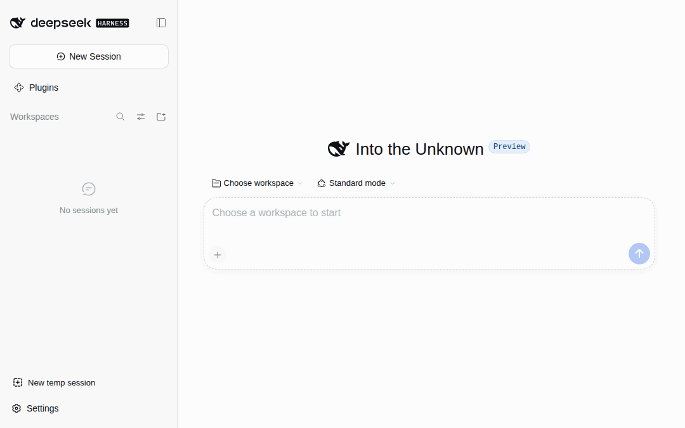

# dsh-tmp-wks：DeepSeek Harness 快捷临时会话

[](https://www.deepseek.com/en/harness/)
[](https://www.npmjs.com/package/@cliven/dsh-tmp-wks)
[](https://github.com/Trisia/dsh-tmp-wks/releases)
[](LICENSE)
[](https://github.com/Trisia/dsh-tmp-wks/actions/workflows/release.yml)



English | [中文](README.zh.md)

## About

*Why this plugin?*


**Every quick question meant leaving DSH to create a folder, coming back to point at that directory, and deleting it by hand afterwards; a throwaway one left uncleaned made several sessions contaminate each other.**

- **Quick create**: one click creates a throwaway workspace and starts a session in it.
- **Safe delete**: removing a workspace asks whether to delete its temp directory on disk too; the default keeps the files.
- **Works everywhere**: usable in both the **DSH Web** UI and the **DSH desktop client**; one install covers both.

## Install

Creates a throwaway workspace with one click and starts a session in it:

```sh
dsh plugin --profile web add @cliven/dsh-tmp-wks
```

## Storage location

Temp workspaces live in **`tmp/` under the DSH home directory**, named `tmp-` plus 6 random characters. The home defaults to `~/.dsh` (override with `$DSH_HOME`), so a default path looks like `~/.dsh/tmp/tmp-k7mq2z`.

## License

[MIT](LICENSE)