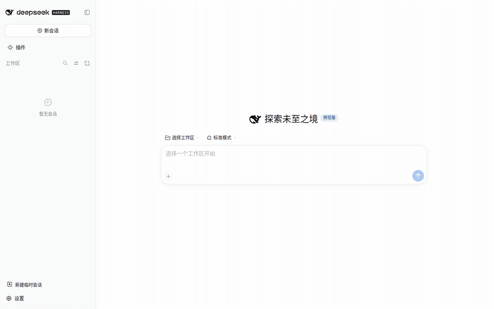

# DeepSeek Harness 快捷临时会话

[](https://www.deepseek.com/en/harness/)
[](https://www.npmjs.com/package/@cliven/dsh-tmp-wks)
[](https://github.com/Trisia/dsh-tmp-wks/releases)
[](LICENSE)
[](https://github.com/Trisia/dsh-tmp-wks/actions/workflows/release.yml)

**D**eep**S**eek **H**arness **T**emporary **W**ork**s**paces (dsh-tmp-wks)



[English](README.md) | 中文

## 关于

*为什么有这个插件？*


**每次有个临时问题都要离开 DSH 创建文件夹，再回来指定目录，用完后还得手工删除；创建一个临时的若是不清理，多个会话的内容又会相互干扰。**

- **快速创建**：一键创建临时工作区并直接在其中开始会话。
- **安全删除**：删除工作区时会询问是否同时删除磁盘上的临时目录，默认保留文件。
- **两端通用**：**DSH Web** 与 **DSH 桌面客户端** 均可使用，一次安装即可。

## 安装

一键创建临时工作区并直接开始一个新会话：

```sh
dsh plugin --profile web add @cliven/dsh-tmp-wks
```

## 存储位置

临时工作区位于 **DSH 主目录下的 `tmp/`**，命名为 `tmp-` 加 6 位随机字符。主目录默认为 `~/.dsh`（可用 `$DSH_HOME` 覆盖），因此默认路径形如 `~/.dsh/tmp/tmp-k7mq2z`。

## 许可证

[MIT](LICENSE)